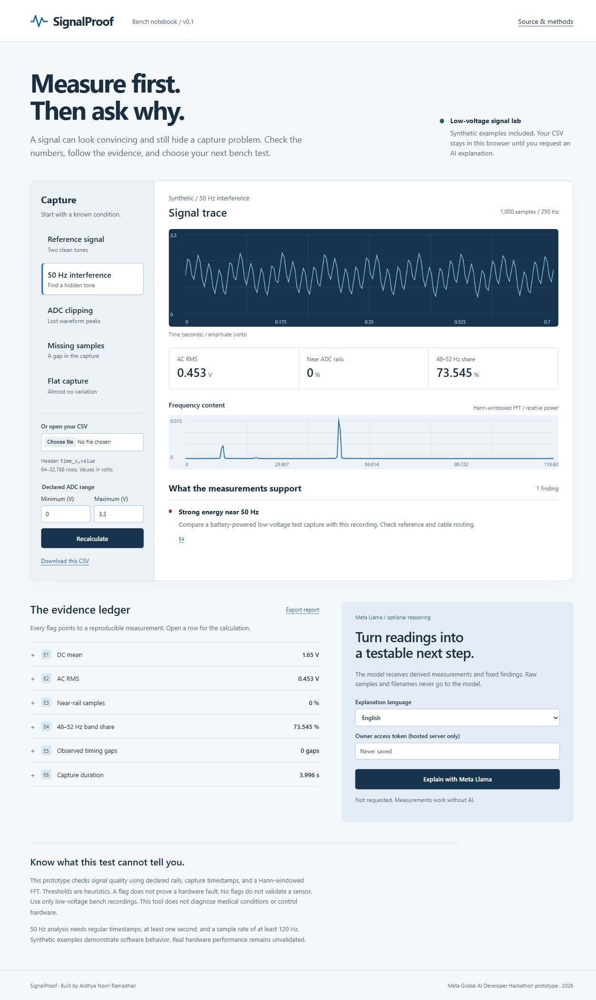

# SignalProof

Measure first. Then ask why.

SignalProof helps engineering students inspect low-voltage sampled signals before trusting an explanation. Open a CSV, inspect reproducible measurements, and optionally ask a Meta Llama model to explain the fixed findings in English or Indonesian. The model cannot change the measurement results.

This is an AI-assisted hackathon prototype built for the Meta Global AI Developer Hackathon, October 2026. Team: SignalProof Lab. Builder: Ardhya Novri Ramadhan.

[Try the static workbench](https://vanovri.github.io/signalproof/) · [Watch the three-minute walkthrough](https://vanovri.github.io/signalproof/docs/demo.html) · [Integration status](docs/status.json)



## Run

Node.js 20 or newer. No npm dependencies or build step.

```sh
npm start
# Open http://127.0.0.1:8789
npm test
npm run evaluate
```

If that port is occupied, set `PORT=8790` before starting. On PowerShell: `$env:PORT='8790'; npm start`.

The static interface also works on GitHub Pages. AI explanations require the Node server and credentials. Opening index.html directly with file:// does not support module loading reliably.

## Meta Llama through Fireworks

Set `FIREWORKS_API_KEY` in the server environment. A key never belongs in client JavaScript. `FIREWORKS_MODEL` selects an available Meta model in your own account. The example model ID is `accounts/fireworks/models/llama-v3p3-70b-instruct`. Availability varies. Its current catalog page lists on-demand access, so do not assume that a serverless call will succeed.

```powershell
# Set FIREWORKS_API_KEY privately in your environment.
$env:FIREWORKS_MODEL='accounts/fireworks/models/llama-v3p3-70b-instruct'
npm start
```

There is no automatic .env loader. The application reads the process environment. For a public server, set `SIGNALPROOF_ACCESS_TOKEN` and enter that token in the UI. Local measurements need no token. Only loopback connections to the default loopback-bound server can request a model response without an owner token. This is a small owner-operated prototype, not a multi-user service.

Each request uses temperature 0, a 700-output-token limit, JSON mode, a 25-second provider timeout, and no automatic retries. The server sends derived measurements, predefined findings, and limitations to Fireworks. It does not send raw samples or filenames to the model. The browser does send samples to the analysis server for recomputation when AI is requested. Do not expose the owner token to untrusted visitors.

The validator checks the JSON structure, required uncertainty, and references to real evidence/finding IDs. It does not prove that every model sentence is scientifically correct. The UI displays that limitation. Missing credentials, provider errors, and invalid output are explicit states. They do not generate a fake AI answer.

## Measurements

CSV header: `time_s,value`. Values are in volts. Declare the actual ADC minimum and maximum. Supply 64 to 32,768 finite samples with strictly increasing timestamps. The upload limit is 2 MB.

| Evidence | Calculation |
| --- | --- |
| E1 | Arithmetic DC mean |
| E2 | RMS after subtracting the DC mean |
| E3 | Fraction within 0.5% of a declared ADC rail, flagged at 1% |
| E4 | 48–52 Hz power divided by 5 Hz to min(200 Hz, Nyquist) power, flagged at 15% |
| E5 | Timestamp intervals above 1.5 times the median interval, plus relative RMS jitter excluding gaps |
| E6 | Duration, sample count, and sample rate inferred from median timestamp spacing |

The spectrum uses the first largest-power-of-two block, DC removal, a Hann window, and a radix-2 FFT. It is withheld for observed timing gaps, relative RMS jitter above 2%, duration below 1 second, or sample rate below 120 Hz. No resampling or gap interpolation occurs. Flat captures have undefined spectral band share. The chart shows the first 0.7 seconds. No gap is drawn as a continuous line.

The thresholds are transparent prototype heuristics. This is not a calibrated instrument, medical diagnostic tool, packet-loss detector, or hardware controller. A 50 Hz component does not establish the source of interference. No flags do not establish valid hardware. Sample rate comes from supplied timestamps, not a clock calibration.

## Verification

`npm test` checks analytic RMS, FFT frequency, fault flags, CSV handling, input limits, timing gaps, credential gating, provider-failure behavior, and model-response validation. Provider tests use explicit mocks. They are not evidence of a live Meta model call.

`npm run evaluate` checks 15 synthetic scenarios across 200, 250, and 500 Hz sampling. The generated [evaluation report](docs/evaluation.json) records construction labels and exact flags. This evaluates deterministic flags, not real-world accuracy or AI answer quality. Hardware evaluation has not been performed.

## Architecture

```text
CSV / synthetic capture
  -> engine.mjs: numeric validation, measurements, fixed findings
  -> browser: waveform, spectrum, evidence ledger, JSON export
  -> optional POST /api/analyze: recompute from samples
  -> Fireworks: Meta Llama explains derived measurements
  -> JSON validation: known evidence and finding IDs, uncertainty
```

`server.mjs` serves an explicit file allowlist. It never serves credentials or source-side environment files. `api/analyze.mjs` also supports a Vercel function. The static site remains usable when no backend exists. `modal_app.py` contains an optional CPU deployment recipe. Modal deployment is separate from a credit request.

## Sources

- [Event and project themes](https://cerebralvalley.ai/e/meta-ai-developer-hackathon)
- [Meta Llama 3.3 on Fireworks](https://fireworks.ai/models/fireworks/llama-v3p3-70b-instruct)
- [Fireworks structured outputs](https://docs.fireworks.ai/structured-responses/structured-response-formatting)
- [Modal web functions](https://modal.com/docs/guide/webhooks)

AI explanations are an implementation target until a live test is documented. See the status report supplied with the submission package for the current account and integration state.
